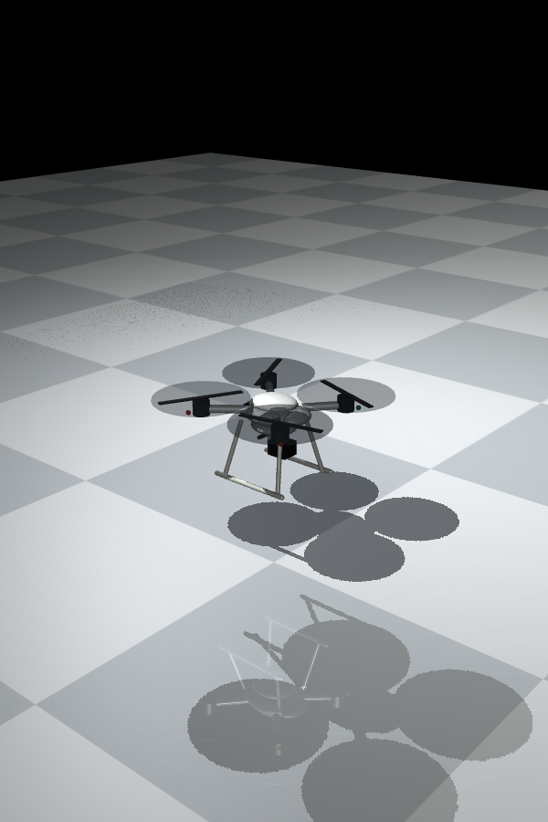
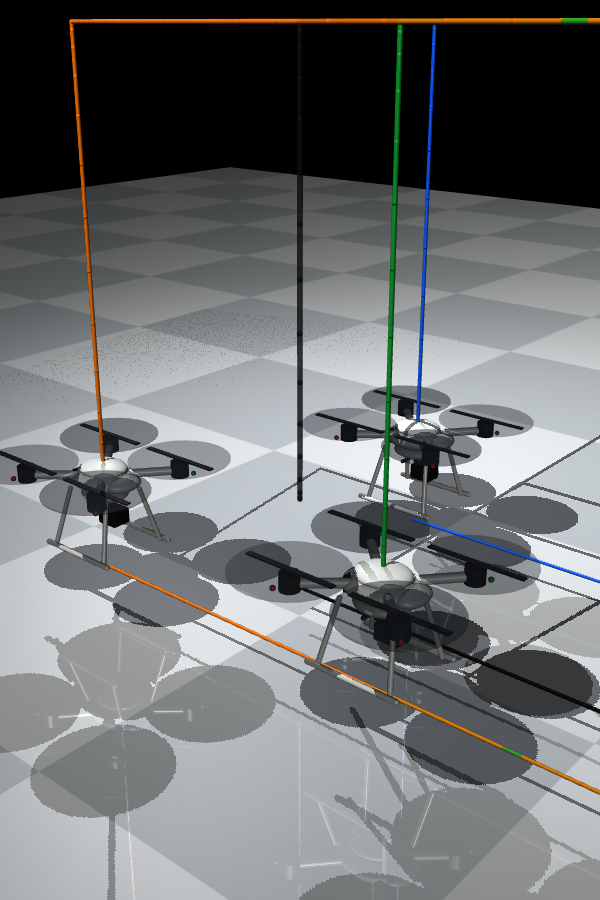

# DJI Phantom 4 Pro 四旋翼 — MuJoCo 模型

在 MuJoCo 中对标大疆 **Phantom 4 Pro** 建立的四轴飞行器模型，几何、质量、惯量与气动系数均按真实参数给出并给出推导来源。当前版本补强了机身外观、旋翼视觉转动和平滑轨迹；单机控制器可演示起飞-悬停-巡航-降落，三机控制器可演示地面起飞后的自主集群收敛。

## 文件

| 文件 | 说明 |
|---|---|
| `phantom4pro.xml` | MuJoCo 模型（几何、质量/惯量、四个螺旋桨参考点 site） |
| `simulate.py` | 仿真 + 几何跟踪控制器 + 电机动态 + 控制分配 |
| `trajectory.npz` | 运行后生成的轨迹数据（`t`, `pos`, `pos_des`, `err`） |
| `trajectory.png` | 运行后生成的跟踪曲线（需 matplotlib） |

## 运行

```bash
python -m pip install -r requirements.txt  # 依赖（包括绘图）
python simulate.py                  # 无头运行，打印跟踪误差 + 保存轨迹图
python simulate.py --render         # 打开 MuJoCo 交互式查看器
python simulate.py --T 20 --dt 0.005
```

双击 `launch_phantom4pro.bat` 也可以直接启动渲染版。

三机编队版：

```bash
python swarm_sim.py
python swarm_sim.py --render
```

双击 `launch_swarm3.bat` 可直接启动三编队集群；脚本会生成 `phantom4pro_swarm.xml` 作为三机模型模板。
三机版运行后会生成 `swarm_paths.png`（随机初始点、三机实际轨迹和目标悬停点）、`swarm_trajectory.png`（位置/间距曲线）以及 `swarm_convergence.png`（目标收敛误差和编队误差）。生成的 MuJoCo 场景里会显示随机初始位置、目标悬停点和最终三角编队标记。
双击 `launch_swarm3.bat` 时会以 0.75 倍速播放，仿真结束后窗口不会自动关闭。Viewer 使用自由相机，可以用鼠标拖动旋转、滚轮缩放；也可以在命令行用 `python swarm_sim.py --render --speed 0.5` 慢速播放。

注意：`phantom4pro.xml` 本身只是被动动力学模型，直接在 MuJoCo 里打开它会在重力作用下下坠。要看它按轨迹飞行，需要运行 `simulate.py`，因为控制器和推力是在 Python 里施加的。
三机版同理，`phantom4pro_swarm.xml` 也只是被动模型，真正的编队控制在 `swarm_sim.py` 里。

三机编队控制器现在采用 **分布式模型预测控制（DMPC）+ 控制屏障函数（CBF）+ SE(3) 几何内环**：

1. 每架无人机用双积分模型预测未来位置和速度，在有限时域内优化目标位置误差、速度误差、编队相对误差、加速度大小和加速度变化量。
2. 编队误差只通过本机状态和最近邻状态预测计算，不需要一个集中式“上帝控制器”。
3. DMPC 的名义加速度经过离散时间 CBF 安全过滤器，显式约束任意机间距离不低于 `0.72 m`；随后再经过 jerk 限制，保持轨迹平滑。
4. 输出的期望加速度交给已有的 SE(3) 姿态控制器，再经过推力/力矩分配、电机一阶动态和 MuJoCo 刚体动力学执行。

任务状态为 **地面起飞 → 巡航收敛 → 目标上方悬停**。三架机初始根部高度约为 `0.099 m`，起落架和地面启用 MuJoCo 接触；起飞高度和随后驶向目标的参考均采用五次多项式，因此起止速度、加速度连续。三架机每次启动时会在目标点周围的随机扇区内生成，仍然保持足够间距；`--seed` 可以复现实验，例如 `python swarm_sim.py --seed 7`。

三机运行输出示例（悬停转速 ≈ 583 rad/s = 5566 RPM，与大疆悬停转速一致）：

```
controller         = distributed MPC + CBF safety filter
final target error  = 0.00 cm
final formation err = 0.02 cm
settling time       = 9.34 s (target + formation < 10 cm)
min pair distance   = 0.79 m
```

---

## 参数总表（DJI Phantom 4 Pro）

### 几何

| 参数 | 数值 | 来源 |
|---|---|---|
| 对角线轴距（wheelbase） | 350 mm | DJI 官方规格 |
| 臂长 `L`（中心→电机） | 0.175 m | = 轴距 / 2 |
| 桨型号 | 9450S（V2.0 为 9455S） | DJI 官方规格 |
| 桨直径 `D` | 9.4 in = 0.2388 m | 9450S |
| 桨半径 `R_prop` | 0.1194 m | D / 2 |

### 质量与惯量

| 参数 | 数值 | 来源 |
|---|---|---|
| 起飞质量 `m` | 1.388 kg（含电池 468 g 与桨） | DJI 官方规格（1388 g） |
| `Ixx = Iyy` | 0.010 kg·m² | 质量分布估算（见下） |
| `Izz` | 0.018 kg·m² | 质量分布估算（见下） |

惯量估算方法（X 构型，四臂沿对角线，臂长 `L`，电机/桨作点质量集中在 `R=L`）：

- 4 根臂按**细杆**处理：`Ixx = Iyy = (2/3) m_arm L²`，`Izz = (4/3) m_arm L²`
- 4 个电机+桨按**点质量**（半径 `L`）处理：`Ixx = Iyy = M_mot L² / 2`，`Izz = M_mot L²`
- 中央机身+电池+云台按**圆盘**（半径 a=0.075 m，高 h=0.12 m）处理：`Ixx=Iyy=m_b(a²/4+h²/12)`，`Izz=m_b a²/2`

代入 `m_arm≈0.16 kg`、`M_mot≈0.28 kg`、`m_b≈0.95 kg`，得到 `Ixx=Iyy≈0.010`、`Izz≈0.018 kg·m²`，与文献中 1.4 kg 级 Phantom 类无人机的惯量区间（Ixx≈0.01、Izz≈0.02）一致。

### 电机（DJI 2312S）

| 参数 | 数值 | 来源 |
|---|---|---|
| KV 值 | 800 rpm/V | DJI 官方 |
| 额定电压 | 14.4 V（4S 电池） | DJI 官方 |
| 最大转速 | 8500 rpm = 890.1 rad/s | DJI 官方 |
| 悬停功率 | 36 W/电机 | DJI 官方 |
| 单电机最大推力 | ≈ 800 g（≈ 7.85 N） | DJI 官方 / 经销商 |

### 气动系数（动量理论 + DJI 悬停功率交叉验证）

| 参数 | 数值 | 推导 |
|---|---|---|
| 空气密度 `ρ` | 1.225 kg/m³ | 标准大气 |
| 推力系数 `k_f` | **1.0×10⁻⁵ N/(rad/s)²** | 见下 |
| 反扭矩系数 `k_m` | **1.5×10⁻⁷ N·m/(rad/s)²** | 见下 |
| 电机时间常数 `τ` | 0.03 s | 小型无刷电机+电调典型值 |
| 旋翼惯量 `I_rotor` | 5.0×10⁻⁵ kg·m² | 桨+电机外转子估算（陀螺项） |

**k_f 推导**：悬停时单电机推力 `T = mg/4 = 1.388×9.81/4 = 3.404 N`。取推力系数 `C_T≈0.10`（小型四旋翼桨典型值），`T = C_T ρ n² D⁴`，解得 `n ≈ 92.5 rev/s = 5548 RPM`（与大疆悬停转速 ~5500 RPM 吻合）。化为 `ω=2πn=581 rad/s`，`k_f = T/ω² = 1.0×10⁻⁵ N·s²/rad²`。

**k_m 推导**：悬停机械功率 `P = 36 W × 0.8（电机效率）= 28.8 W`，`Q = P/ω = 0.0496 N·m`，`k_m = Q/ω² ≈ 1.5×10⁻⁷ N·m·s²/rad²`。等价地 `C_Q = k_m·(2πn)²/(ρn²D⁵)≈0.0064`，属小型桨典型区间。

**一致性自检**（这些值彼此自洽，是参数可信的关键证据）：

1. 最大推力：`k_f·ω_max² = 1.0×10⁻⁵ × 890.1² = 7.92 N ≈ 807 g`，与 DJI 标称单电机最大推力 ~800 g **一致**；
2. 悬停转速：`ω_hover = √(mg/4k_f) = 581 rad/s = 5548 RPM`，与 Phantom 悬停 ~5500 RPM **一致**；
3. 推重比：最大总推力 `4×7.92 = 31.7 N` / 重量 `13.6 N` = **2.3**，符合 Phantom 级别。

---

## 动力学模型

坐标系：机体 `x` 前、`y` 左、`z` 上；世界系 `z` 上。X 构型（四臂沿 45° 对角线），`l = L/√2 = 0.1237 m`。

| 电机 | 位置 (body) | 旋向（俯视） | `s_i` |
|---|---|---|---|
| 0 右前 | (+l, −l) | 顺时针 CW | −1 |
| 1 左前 | (−l, −l) | 逆时针 CCW | +1 |
| 2 左后 | (−l, +l) | 顺时针 CW | −1 |
| 3 右后 | (+l, +l) | 逆时针 CCW | +1 |

每个旋翼产生的力/力矩（`ω_i` 为转速，rad/s）：

```
推力      F_i = k_f · ω_i²          (沿机体 +z，始终向上)
反扭矩    T_i = s_i · k_m · ω_i²    (绕机体 z，与旋向相反)
```

总推力与力矩 → 转速平方的映射（控制分配矩阵，代码中数值求解 `B⁻¹`）：

```
[ f      ]   [  kf    kf    kf    kf   ] [ ω0² ]
[ τx     ]   [ -kf·l -kf·l +kf·l +kf·l ] [ ω1² ]
[ τy     ] = [ -kf·l +kf·l +kf·l -kf·l ] [ ω2² ]
[ τz     ]   [ -km   +km   -km   +km   ] [ ω3² ]
```

**附加物理项**：

- 推力力臂产生的俯仰/滚转力矩 `r_i × F_i`（自动包含）；
- 旋翼陀螺力矩 `τ_gyro = h × Ω`，`h = I_rotor·(Σ s_i ω_i)·ẑ`（悬停时两正两反抵消，`h≈0`，仅在剧烈机动时可见）；
- 电机一阶动态 `dω/dt = (ω_cmd − ω)/τ`，并饱和在 `[0, ω_max]`。

> 实现说明：所有力/力矩在**机体坐标系**中计算后一次性旋转到世界系，写入 `data.xfrc_applied`（MuJoCo 的世界系 6 维外力接口）。原因见下文「MuJoCo 执行器说明」。

## 控制器

集群外环（`swarm_sim.py`）：

1. **DMPC 预测模型**：`p(k+1)=p(k)+v(k)dt`，`v(k+1)=v(k)+a(k)dt`。
2. **局部优化目标**：目标参考、邻居相对编队偏移、速度、加速度和加速度变化量，并执行滚动时域优化，只施加第一步加速度。
3. **CBF 安全过滤**：对 `h_ij = ||p_i-p_j||²-d_safe²` 建立离散时间线性约束，投影名义加速度，避免依赖普通排斥势场。
4. **平滑与执行**：jerk/加速度限幅 → SE(3) 几何内环 → 电机动态 → MuJoCo。

单机几何跟踪控制器（`simulate.py`）：

1. **位置环**：`a_d = K_p e_p + K_d e_v + a_ref`，所需推力方向 `z_Bd = normalize(m(a_d + g))`；
2. **姿态环**：由 `z_Bd` 与目标偏航构造期望旋转 `R_d`，误差 `e_R = ½(R_dᵀR − RᵀR_d)^∨`，`e_ω = ω`，力矩 `τ = −K_R e_R − K_ω e_ω`；
3. **分配**：`[f, τ] → B⁻¹ → ω_cmd`。

增益：`K_p = [3, 3, 6]`，`K_d = [2.5, 2.5, 4]`，`K_R = 2.0`，`K_ω = 0.4`。

## MuJoCo 执行器说明（重要）

MuJoCo 的 `general` 执行器用 `site` 传输施加 6 维力时，实测（mujoco 3.12）存在坐标系不一致：

- `gear[0:3]`（力）作用于 **site 坐标系**（跟随机体）——正确；
- `gear[3:6]`（力矩）作用于 **世界坐标系**（不跟随机体）——倾斜时偏航方向会出错；
- 且 `refsite` 指向自身/原点时力会被抵消为零。

因此本模型改用 `data.xfrc_applied`（文档明确为世界系 6 维外力）在控制器里显式施加推力+反扭矩+陀螺项，保证每个量都在机体坐标系内、跟随机体倾转。这也是 MuJoCo 四旋翼模型的常见做法。

---

## 如何换机型 / 扩展

- **换大疆机型**：改 `phantom4pro.xml` 的 `<inertial>`（质量/惯量）与 `simulate.py` 顶部常量（`MASS/KF/KM/L`），并相应改 site/arm 几何。例如 Mavic 3（895 g、轴距 335 mm）、Mavic Air 2（570 g、302 mm）。
- **加地面/降落**：三机脚本会为地面和起落架分别设置碰撞类别；如果扩展单机模型，可沿用 `phantom4pro_swarm.xml` 中的 `contype/conaffinity` 设置。
- **更真实的桨**：把四个螺旋桨建模为铰接自转刚体（`hinge` + `motor`），让旋翼陀螺效应由 MuJoCo 自然产生（此时可去掉 `apply_forces` 里的陀螺项）。
- **真实电机电气模型**：可用 `general` 执行器 `dyntype="dcmotor"` 或 `"filter"` 做一阶滤波，但注意上面的坐标系坑。

## 参考来源

- [DJI Phantom 4 Pro 技术规格 — drdrone.ca](https://drdrone.ca/pages/phantom-4-pro-technical-specifications)
- [Phantom 4 Pro Specs — 3D Insider](https://3dinsider.com/phantom-4-pro-specs/)
- [DJI Phantom 4 Pro 支持页](https://www.dji.com/support/product/phantom-4-pro)
- [DJI 2312S 电机（800 KV）规格 — rc-hobby](https://rc-hobby.com.ua/elektrodviguni/dji-p4-2312scw-p24/)
- Lee, T., Leok, M., & McClamroch, N. H. (2010). *Geometric tracking control of a quadrotor UAV on SE(3).* IEEE CDC.
- Mayne, D. Q., et al. (2000). *Constrained model predictive control: Stability and optimality.* Automatica.
- Dai, L., Cao, Q., Xia, Y., & Gao, Y. (2017). [*Distributed MPC for formation of multi-agent systems with collision avoidance and obstacle avoidance.*](https://doi.org/10.1016/j.jfranklin.2016.12.021)
- Ames, A. D., et al. (2017). [*Control Barrier Function Based Quadratic Programs for Safety Critical Systems.*](https://doi.org/10.1109/TAC.2016.2638961) IEEE TAC.
- Lee, T., Leok, M., & McClamroch, N. H. (2011). [*Nonlinear Robust Tracking Control of a Quadrotor UAV on SE(3).*](https://doi.org/10.48550/arXiv.1109.4457)


## 教学版和展示

`simulate_annotated.py` 是带中文详细注释的单机教学版；实际编队控制使用
`swarm_sim.py` 和 `simulate.py`。`无人机集群MuJoCo仿真指南.md` 是从单机扩展
到多机的教程，其中简化骨架和势场例子用于教学；当前可执行集群控制算法以
本目录脚本和上文 DMPC/CBF 说明为准。





运行生成的 `.npz` 轨迹和曲线图片不纳入版本控制。`phantom4pro_swarm.xml`
是集群脚本可重新生成的示例场景，实际初始位置请用 `--seed` 固定。
